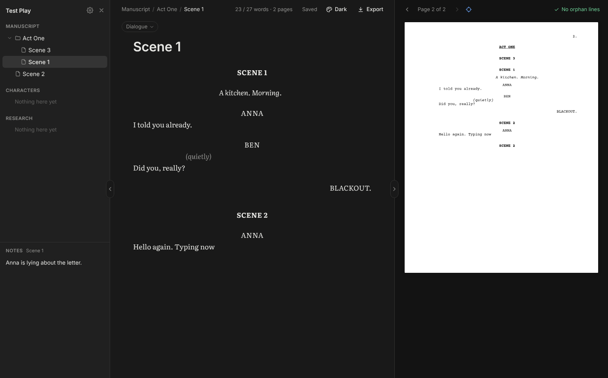

# Many Write

A local-first desktop writing app for **stage plays, screenplays, books, articles and poems**.

- **Binder with notes**: acts, scenes, characters and research in a sidebar, with a notes file beside each item.
- **Script formatting with Enter/Tab flow**: type a name and press Enter for dialogue; press Enter again for the next speaker.
- **Live typeset preview**: the actual page, updated as you type, with a checked **"No orphan lines"** status.
- **Plain files**: every scene is a markdown file in a folder you own. No account, no cloud, no lock-in.


| Dark | Pink | Theme builder |
| --- | --- | --- |
|  |  |  |

## Writing a play

| You do | You get |
| --- | --- |
| Type a name, press **Enter** | The next line is **dialogue** |
| Press **Enter** after dialogue | A new **character** line for the next speaker |
| Press **Enter** on an empty character line | It becomes a **stage direction** |
| Press **Enter** on an empty line again | It cycles on to **transition**, then **scene heading** |
| Type **(** on an empty dialogue line | A **parenthetical**, with the cursor inside `()` |
| **Tab** / **Shift-Tab**, or the type menu | Change the current line's type |
| **⌘⌥1…6** (Ctrl+Alt on Windows/Linux) | Jump to a specific type |
| Type the start of a known name | It is suggested; **Enter**, **Tab** or **→** accepts, **Esc** dismisses |

Screenplays have their own Enter/Tab flow. Poems keep every line break and indent exactly (Tab indents). Books and articles use paragraphs, headings and quotes.

## Your files

```
My Play/
  project.json            title, author, format, theme, binder order
  README.md               explains the convention to anyone opening the folder
  manuscript/01-act-one/01-scene-1.md
  characters/  research/  notes/  exports/  .trash/
```

A scene file reads like this in any text editor or Obsidian:

```markdown
## Scene 1

A kitchen. Morning.

ANNA
(quietly)
I told you already.

> BLACKOUT.
```

The full convention, including the rules for lines that could be a cue or a direction, is in [docs/FILE-FORMAT.md](docs/FILE-FORMAT.md). It is Fountain-compatible.

- Changes save about a second after you stop typing, as an atomic write. There is no save button.
- If a file changes on disk while it's open, the app reloads it. If you were mid-edit at the time, it asks which version to keep and puts the other one in `.trash/`. It never overwrites silently.
- Dropbox, iCloud, OneDrive and Syncthing conflict copies are detected and flagged.
- Reordering in the binder renames the number prefixes. It never rewrites the contents of a file.

## Export

| Format | Notes |
| --- | --- |
| **PDF** | Comes from the same Typst engine as the preview. Widow/orphan control is enforced, a cue is never stranded and a parenthetical stays with its dialogue. Each export is verified. |
| **Word (.docx)** | Paragraph styles with keep-with-next and widow control. Word repaginates on open. |
| **EPUB 3** | For books, articles and poems. Reflowable. |
| **Final Draft (.fdx)** | XML for scripts. Final Draft repaginates on open. |
| **Fountain** | Plain-text screenplay format. |

## Install

Download an installer from [Releases](../../releases). The builds are not code-signed yet:

- **macOS**: right-click the app, choose **Open**, then **Open** again. Or run `xattr -dr com.apple.quarantine "/Applications/Many Write.app"`.
- **Windows**: SmartScreen says "Windows protected your PC". Click **More info**, then **Run anyway**.
- **Linux**: install the `.deb`, or `chmod +x` the AppImage and run it.

## Develop

You need Node 22+ and Rust (stable). On Linux you also need the [Tauri system libraries](https://tauri.app/start/prerequisites/).

```bash
npm install
```

```bash
npm run tauri dev
```

The second command runs the desktop app with hot reload. To work in a browser instead, run `npm run dev`. It starts the core on localhost and serves the UI at http://localhost:1420. Both modes run the same Rust code.

```bash
npm test && cargo test -p manywrite-core
```

```bash
node e2e/smoke.mjs && node e2e/templates.mjs
```

The last command runs the end-to-end checks against `npm run dev` and needs Playwright.

```bash
npm run tauri build
```

This builds installers for the current platform. CI builds macOS, Windows and Linux installers when you push a `v*` tag (see `.github/workflows/release.yml`).

### Layout

| Path | What |
| --- | --- |
| `crates/manywrite-core` | Rust: file storage (atomic writes, conflict checks), the embedded Typst engine, the layout checker, and DOCX/EPUB writers. Typst templates are in `src/templates/`. |
| `src-tauri` | Desktop shell: one `mw_call` command into the core. |
| `crates/manywrite-devserver` | The same core over localhost HTTP, for browser development and tests. |
| `src/formats` | Templates (element types, Enter/Tab rules), the markdown convention, Typst generation, Fountain/FDX. |
| `src/project` | The open project: binder, autosave queue, outside-edit polling. |
| `src/editor` | TipTap/ProseMirror editor with the script keymap. |

**How "No orphan lines" is measured.** After each layout, the core walks every glyph on every page and traces it back to the line you typed, using Typst source spans. It then counts the lines of each paragraph on each page and checks that every cue, parenthetical and heading shares a page with what follows it. The status reflects that measurement. It is not a setting. A test in `crates/manywrite-core/tests/layout.rs` switches the rules off and confirms the checker catches the problems.

## Licence

Apache-2.0. Fonts and libraries are listed in [THIRD-PARTY.md](THIRD-PARTY.md). "Final Draft" and "Scrivener" are trademarks of their owners. Many Write is not affiliated with them.
