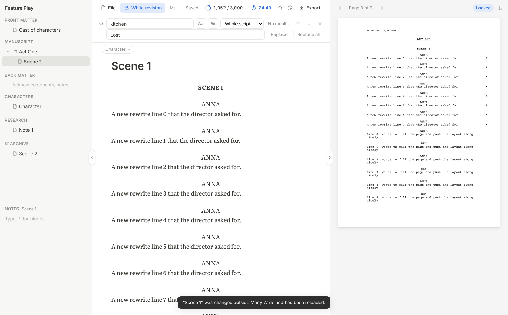
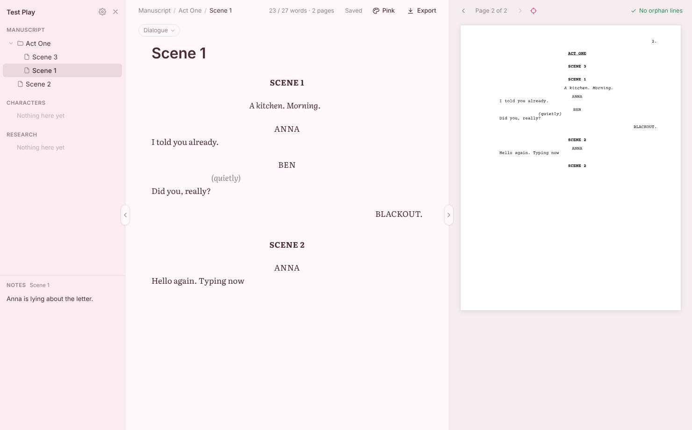
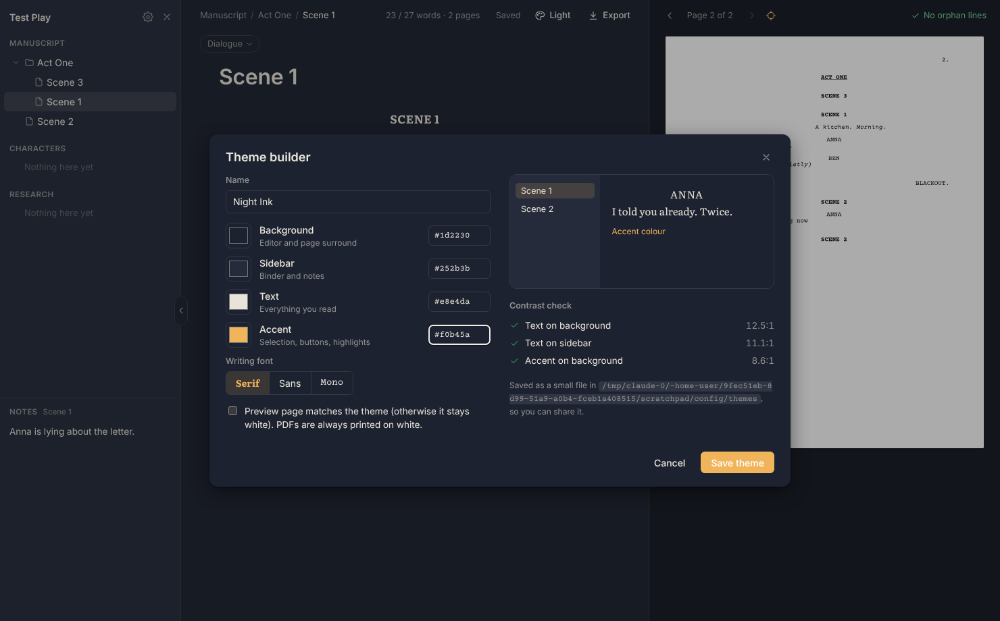
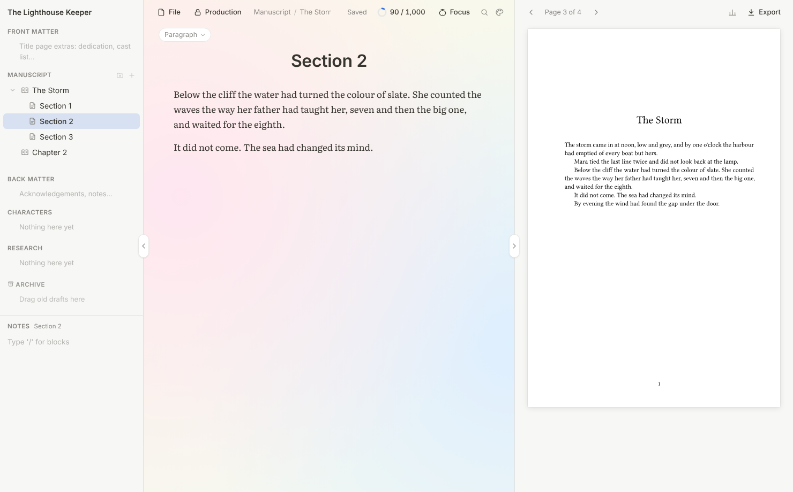
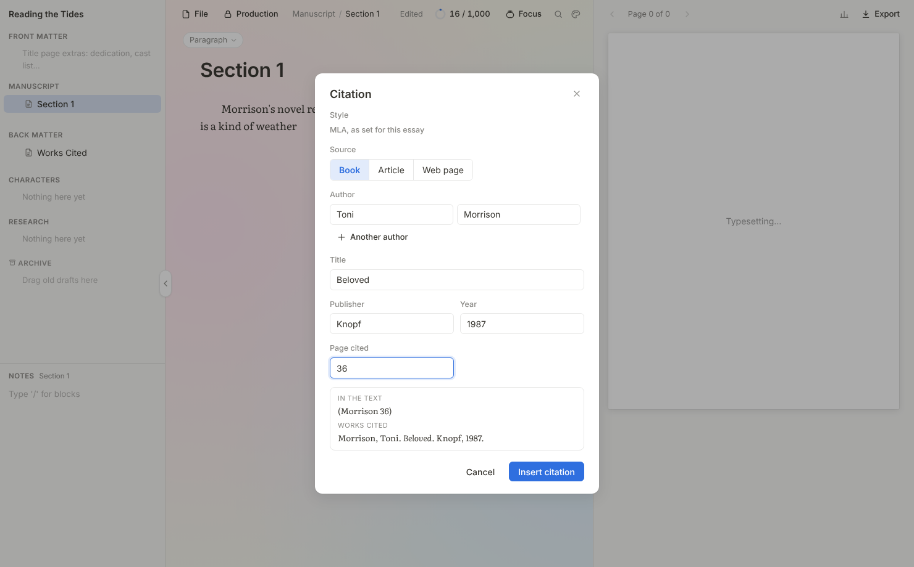
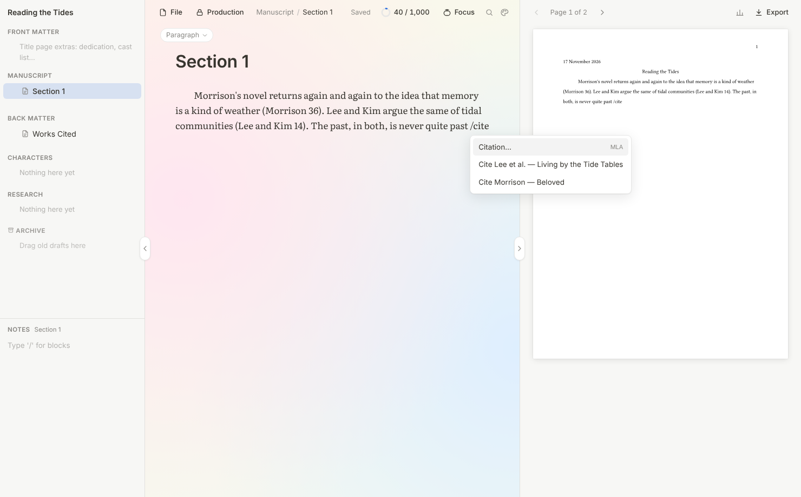

# Many Write

A local-first desktop writing app for **stage plays, screenplays, essays, books, articles, poems and plain documents**.

- **Binder with notes**: acts, scenes, characters and research in a sidebar, with a notes file beside each item.
- **Script formatting with Enter/Tab flow**: type a name and press Enter for dialogue; press Enter again for the next speaker.
- **Live typeset preview**: the actual page, updated as you type. Orphan lines and stranded cues are prevented and checked; a warning appears only if something goes wrong.
- **Production mode**: lock page numbers for revisions. Rewrites go onto A-pages (12A, 12B…), changed lines get a margin asterisk, and the header names the revision colour.
- **Notion-style pages**: type `/` anywhere for blocks. Characters and research pages have to-dos, lists, callouts, dividers and images.
- **Open and import**: open a single document on its own, or import Word, Final Draft, Fountain, PDF and RTF files.
- **Play collections**: a trilogy or an evening of one-acts in one project. Each play has its own title page and front matter; import a Final Draft or Fountain file straight into each play.
- **Plain files**: every scene is a markdown file in a folder you own. No account, no cloud, no lock-in.


| Production mode | Character page | Words and pages |
| --- | --- | --- |
|  |  |  |

| Dark | Pink | Theme builder |
| --- | --- | --- |
|  |  |  |

| Book chapters with sections | Citing a source with /cite | Sources remembered |
| --- | --- | --- |
|  |  |  |

## Writing a play

| You do | You get |
| --- | --- |
| Type a name, press **Enter** | The next line is **dialogue** |
| Press **Enter** after dialogue | A new **character** line for the next speaker |
| Press **Enter** on an empty character line | It becomes a **stage direction** |
| Press **Enter** on an empty line again | It cycles on to **transition**, then **scene heading** |
| Type **(** on an empty dialogue line | A **parenthetical**, with the cursor inside `()` |
| **Tab** / **Shift-Tab**, or the type menu | Change the current line's type |
| **⌘⌥1…6** (Ctrl+Alt on Windows/Linux) | Jump to a specific type |
| A character line | A list of the names you have used; type to filter, **↑ ↓** and **Enter** (or click) to pick |
| **(** after a name, or a whole name | **(CONT'D)**, **(V.O.)**, **(O.S.)** and **(O.C.)** to add after it |
| **/** at the start of a line | The block menu: type to filter (`/trans`, `/todo`, `/image`), **Enter** to apply |

Each scene starts on a new page, and a character who speaks again after a stage direction can get **(CONT'D)** automatically on the page (both in File › Project settings). Screenplays have their own Enter/Tab flow. Poems keep every line break and indent exactly (Tab indents). Books and articles use paragraphs, headings and quotes. Books, articles and documents also have **text-message bubbles** (`/text`, left or right), and a book's scene breaks can be asterisks, a line, three hearts or your own picture (File › Project settings).

**Books** can split a chapter into **sections**: hover over a chapter and press **+**. The chapter becomes a folder (its text is kept as Section 1) whose title prints as the chapter heading, and its sections run on one after another, with no heading or page break between them.

**Page breaks**: stage plays, poems, play collections and documents start each scene, poem or page on a new page. Screenplays, essays, articles and a book chapter's sections run on, in the preview and in PDF, Word and EPUB exports (scripts can change this in File › Project settings).

**Citations**: in essays, books, articles and documents, type **/cite** for **Citation…**. Enter the source (book, article or web page) and the page. In MLA the in-text citation goes at the cursor, `(Morrison 23)`; in Chicago notes a superscript marker goes there and the note carries the full reference, printed at the foot of the page or in an **Endnotes** section, whichever the essay's settings say. Word exports carry real footnotes or endnotes; EPUB exports link each marker to an Endnotes page with backlinks. The full entry goes in alphabetical order on the **Works Cited** or **Bibliography** page, which is made if there isn't one. Every source is remembered: the next **/cite** lists it, so citing it again is one click (the cursor waits for the page number). In Chicago notes, type **/note** for a note that is not a citation, and click a note marker to edit or delete it. If **Zotero 7** is running on the same computer, **From Zotero…** searches your library through its local API and fills in the source for you (if the search fails while Zotero is open, turn on **Allow other applications on this computer to communicate with Zotero** in Zotero's Advanced settings).

**Essays** come in **MLA** or **Chicago notes–bibliography** style, chosen when you create the project: double-spaced 12pt pages, MLA's heading block and "Surname 1" running header, or Chicago's title page, superscript notes and bibliography. Chicago notes print as **footnotes** or **endnotes**, chosen in File › Project settings. A **Works Cited** (MLA) or **Bibliography** (Chicago) page is added to the back matter with example entries; each `- ` line is one source with a hanging indent. Both are also offered for any project under Back matter › +. Instructor, course and date are in File › Project settings. Older projects made with Chicago author–date still open and print as they did.

## Around the editor

- **New pages start empty**: a new scene, chapter, character or front matter page has no text in it, just grey hint text (its name, “For …” on a dedication, an example source on a Works Cited page) that disappears as you type.
- **Nested lists**: in a bulleted, numbered or to-do list, press **Enter** on an empty item to indent it a level, and **Backspace** at the start of an item to bring it back out (on a top-level item, Backspace leaves the list). **Tab** and **Shift-Tab** do the same. Each level is numbered on its own, and nesting is kept in PDF, Word and EPUB exports.
- **Blank lines are kept**: press Enter twice for an empty line, and it stays an empty line on the page and in Word, EPUB and PDF exports.
- **Links**: web addresses are clickable in the editor (Alt-click to edit one) and in exported PDFs.
- **Several windows**: File › New window, or the window button next to a recent project, opens another project side by side.

- **Binder**: front matter (cast list, dedication, time and place…), the manuscript, back matter, characters, research and an **archive** for old drafts. Drag to reorder, nest or archive. **⌘/Ctrl-click** or **Shift-click** to select several items and drag, archive or trash them together; drop at the bottom of a section to take items out of a folder. Click an item's **icon** to choose a different one (there are 40, including a monster, an octopus and tick boxes for to do and done). New scenes go next to the one you're on.
- **Notes**: every binder item has a notes page below the binder, with the same `/` blocks.
- **Find & replace** (⌘F, or ⌘⇧F for the whole script): match case, whole words, every result listed, replace one or all. Bold and italics are kept.
- **Words and pages**: the chart button above the preview lists words and pages for each scene, with totals and a running-time estimate for scripts.
- **Subtitle**: File › Project settings › Subtitle prints under the title on the title page (and in Word, EPUB and Final Draft exports). Front and back matter pages, like scenes, don't print their binder titles.
- **Copyright page**: Front matter › + › Copyright lets you tick the clauses you want (all rights reserved, fiction, moral rights, external content, designations, edition, ISBN). They are common wording, not legal advice: you decide what to keep or add.
- **Archive button**: the box icon next to the trash can moves a chapter or scene to the Archive.
- **Theme pictures**: a custom theme can have a background picture behind the editor, with a slider for how strongly it shows.
- **Goals**: a daily word goal with a progress ring, a project goal with a deadline, and this week's progress, laid out the way your computer's calendar is (Sunday- or Monday-first).
- **Pomodoro timer**: the tomato in the top bar. Focus and break lengths you choose, and a happy ding when time is up.
- **File menu**: new project, new or open single document, import, recent projects, spell check on or off. Spelling uses the system dictionary on macOS, Windows and Linux.

## Production mode

When a script is going into rehearsal or production, choose **Production › Lock pages**. From then on:

- every page keeps its number; a cut leaves white space instead of renumbering;
- the first time you edit a locked page, its **old version is moved to the Archive** ("Page 3 — replaced in White revision") and the page prints as **3A**; if the rewrite runs long, it continues on 3B;
- you choose the letter: the Production panel lists every revised page with a picker (3, 3A, 3B…) and a link to its old version;
- changed and new lines are marked with **\*** in the right margin, and the header shows the revision colour (White, Blue, Pink, Yellow, Green, Goldenrod…) and date;
- **Start next revision** moves to the next colour and clears the marks; revised pages keep their letters, and a page edited again moves on (3A → 3B), with its previous version archived too;
- **Leave production mode** lets pages flow freely again.

Locks follow their lines even when you add or cut lines above them.

## Play collections

Choose **Play collection** when you create a project (or press the masks button above the manuscript in any stage play) to add a whole play: a folder with its own title page, a **Front matter** folder for that play's cast list and time and place, and Act One. Each play's acts and scenes are numbered from page 1.

To bring in an existing script, hover over a play and press the import button: its scenes go into that play (replacing the empty Scene 1 of a new play), and the play takes its title from the Final Draft title page. Fountain, Word, PDF and RTF scripts work the same way.

## Open and import

- **Open document…** edits a single `.md`, `.txt` or `.fountain` file in place, with the preview and exports, without creating a project. Plain files open in the **Document** format: headings, paragraphs, lists, to-dos, quotes and callouts, typeset as a clean page.
- **Import…** creates a new project from:

| From | What comes across |
| --- | --- |
| Word (.docx) | Opens as one Document with its headings, paragraphs and bold/italic/underline; choose Book to split it into chapters at its top headings. Script styles (Character, Dialogue…) become script elements |
| Final Draft (.fdx) | Every element and its emphasis, split into scenes; the title from the title page |
| Fountain | Elements, title page, scenes |
| PDF | The text, rebuilt into paragraphs; scripts are recognised and rebuilt into cues, dialogue, parentheticals and scenes. Scanned PDFs need text recognition first |
| RTF | Paragraphs and emphasis |

The original file is never changed.

## Your files

```
My Play/
  project.json            title, author, format, theme, binder order
  README.md               explains the convention to anyone opening the folder
  manuscript/01-act-one/01-scene-1.md
  characters/  research/  notes/  exports/  .trash/
```

A scene file reads like this in any text editor or Obsidian:

```markdown
## Scene 1

A kitchen. Morning.

ANNA
(quietly)
I told you already.

> BLACKOUT.
```

The full convention, including the rules for lines that could be a cue or a direction, is in [docs/FILE-FORMAT.md](docs/FILE-FORMAT.md). It is Fountain-compatible.

- Changes save about a second after you stop typing, as an atomic write. There is no save button.
- If a file changes on disk while it's open, the app reloads it. If you were mid-edit at the time, it asks which version to keep and puts the other one in `.trash/`. It never overwrites silently.
- Dropbox, iCloud, OneDrive and Syncthing conflict copies are detected and flagged.
- Reordering in the binder renames the number prefixes. It never rewrites the contents of a file.

## Export

| Format | Notes |
| --- | --- |
| **PDF** | Comes from the same Typst engine as the preview. Widow/orphan control is enforced, a cue is never stranded and a parenthetical stays with its dialogue. Each export is verified. Export every page, or only the pages you choose (for example `1-3, 7, 10-`, counted as in the preview). |
| **Word (.docx)** | Paragraph styles with keep-with-next and widow control. Word repaginates on open. |
| **EPUB 3** | For books, articles and poems. Reflowable. |
| **Final Draft (.fdx)** | XML for scripts. Final Draft repaginates on open. |
| **Fountain** | Plain-text screenplay format. |

## Install

Download an installer from [Releases](../../releases). The builds are not code-signed yet:

- **macOS**: right-click the app, choose **Open**, then **Open** again. Or run `xattr -dr com.apple.quarantine "/Applications/Many Write.app"`.
- **Windows**: SmartScreen says "Windows protected your PC". Click **More info**, then **Run anyway**.
- **Linux**: install the `.deb`, or `chmod +x` the AppImage and run it.

## Develop

You need Node 22+ and Rust (stable). On Linux you also need the [Tauri system libraries](https://tauri.app/start/prerequisites/).

```bash
npm install
```

```bash
npm run tauri dev
```

The second command runs the desktop app with hot reload. To work in a browser instead, run `npm run dev`. It starts the core on localhost and serves the UI at http://localhost:1420. Both modes run the same Rust code.

```bash
npm test && cargo test -p manywrite-core
```

```bash
node e2e/smoke.mjs && node e2e/templates.mjs && node e2e/features.mjs && node e2e/imports.mjs
```

That runs the end-to-end checks against `npm run dev` (it needs Playwright).

```bash
npm run tauri build
```

This builds installers for the current platform. CI builds macOS, Windows and Linux installers when you push a `v*` tag (see `.github/workflows/release.yml`).

### Layout

| Path | What |
| --- | --- |
| `crates/manywrite-core` | Rust: file storage (atomic writes, conflict checks), the embedded Typst engine, the layout checker, and DOCX/EPUB writers. Typst templates are in `src/templates/`. |
| `src-tauri` | Desktop shell: one `mw_call` command into the core. |
| `crates/manywrite-devserver` | The same core over localhost HTTP, for browser development and tests. |
| `src/formats` | Templates (element types, Enter/Tab rules), the markdown convention, Typst generation, Fountain/FDX. |
| `src/project` | The open project: binder, autosave queue, outside-edit polling. |
| `src/editor` | TipTap/ProseMirror editor with the script keymap. |

**How "No orphan lines" is measured.** After each layout, the core walks every glyph on every page and traces it back to the line you typed, using Typst source spans. It then counts the lines of each paragraph on each page and checks that every cue, parenthetical and heading shares a page with what follows it. The status reflects that measurement. It is not a setting. A test in `crates/manywrite-core/tests/layout.rs` switches the rules off and confirms the checker catches the problems.

## Privacy and security

- **No internet, ever.** The desktop app contains no networking code: no updater, telemetry, analytics or font downloads. Its window may only talk to its own core (`connect-src ipc:` in the content security policy), Typst cannot fetch packages, and every font is bundled. Your writing never leaves your computer.
- **Text is never code.** Everything you type (or import) reaches the typesetter only inside string literals, so it cannot run as Typst code; this is fuzzed with hostile input. The UI never inserts HTML; the preview is shown as an image.
- **Imported files are untrusted.** Word/zip, PDF and RTF readers are bounds-checked, refuse decompression bombs (64 MB per entry), cannot be steered outside the project being imported, and a damaged file produces an error rather than a crash (`crates/manywrite-core/tests/security.rs`).
- **Saves are safe.** Atomic writes, conflict detection, and nothing is deleted: removed items and replaced versions go to the project's `.trash/` or `archive/`.
- **The browser dev server** (`npm run dev`, never shipped) only answers the Many Write page on `localhost`; requests from other websites and DNS-rebinding attempts are refused. To view it through a forwarding proxy (a hosted preview), start Vite with `MW_PREVIEW=1`; the app's request header is still required. **`MW_PREVIEW=1` turns off the Host and Origin checks, so the file API is then reachable by anything that can reach the port: use it only on a throwaway machine with a project you can lose, never on your own writing.**
- **Build-only dependencies.** `npm audit` reports advisories in the Vite/Vitest toolchain (currently a ReDoS in `picomatch`, `GHSA-fc5q-39xc-vjpf`). These packages run only on a developer's machine while building or testing; none of them is shipped in the desktop app or the Rust core, and none parses untrusted input at runtime. No patched release existed when this was written; `.github/dependabot.yml` keeps the toolchain current so the fix is picked up automatically when it ships.

## Licence

Apache-2.0. Fonts and libraries are listed in [THIRD-PARTY.md](THIRD-PARTY.md). "Final Draft" is a trademark of its owner. Many Write is not affiliated with it.
